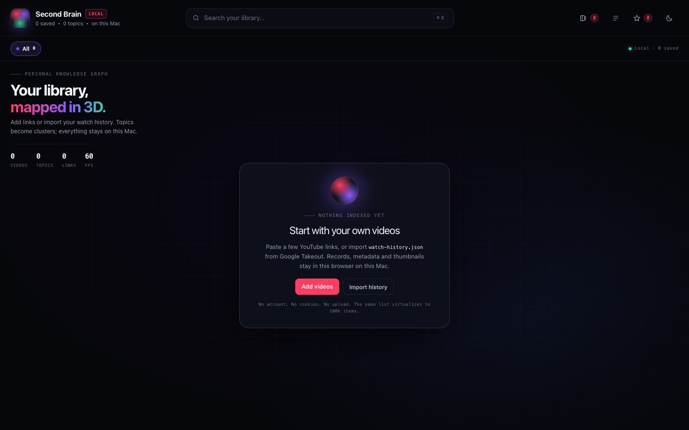
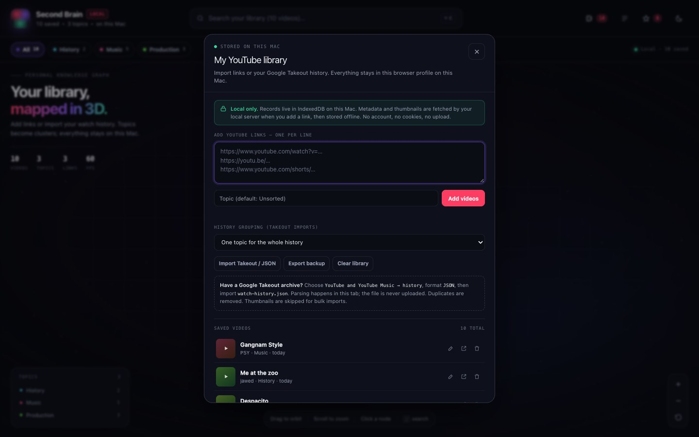

# Second Brain

A **private, local-first 3D map of your own YouTube library**. Paste links or import your Google
Takeout watch history, and the app turns your topics into a navigable graph. Videos, metadata and
thumbnails are stored in your browser on this Mac. Nothing is uploaded, and no account is used.

Built to stay smooth at **100,000 videos** — without shipping a single seeded record.


## What it is

- **Empty by default.** No demo corpus, no fake catalogue, no 100k download. You add what you want.
- **Add by link** — one URL per line; title, channel and thumbnail are fetched through a local-only
  proxy and stored offline.
- **Import Google Takeout** — drop `watch-history.json`; it is parsed in the tab, deduplicated and
  grouped by year, channel, a single topic, or **auto-detected from titles**.
- **Auto-organize** — a local, rule-based classifier labels each title with a topic and up to five tags
  (Rust, LLM, Finance, Ads & Promos, …). No model call, no network.
- **3D knowledge graph** — each topic is a sphere, size is `log(video count)`. Positions are laid out
  locally; no physics loop runs while you read.
- **Virtualized drawer** — 10–14 DOM rows whether a topic has 60 videos or 3,765.
- **Local search** — MiniSearch over the whole library, built in an idle slot; substring fallback
  before the index is ready.
- **Bookmarks and theme** in `localStorage`; the library itself in IndexedDB.
- **Deep links** — `#/topic/<id>`, `#/topic/<id>?v=<videoId>`, `#/saved`.
- **Export** a JSON backup at any time.

It is **not** a YouTube downloader, a scraper, an OAuth client, or a hosted service. It never asks for
your Google password or cookies. Watch history cannot be fetched programmatically; Google Takeout is the
supported path.

## Start it locally

```sh
cd ~/Projects/youtube-second-brain
npm install          # dev-only: puppeteer-core for the release gate
npm run local        # serves on http://127.0.0.1:9000 and opens the browser
```

Or double-click **`Start Second Brain.command`** in Finder (right-click → Open the first time). Keep the
Terminal window open; `Ctrl+C` stops the server.

The server binds to `127.0.0.1` only. The personal library lives in this browser profile, under the
`http://127.0.0.1:9000` origin. If you change the port, the browser sees a different origin and the
library will appear empty.

## Add your videos

### Paste links

1. Open the library icon in the header (or **Add videos** on the empty state).
2. Paste `youtube.com/watch?v=…`, `youtu.be/…`, `youtube.com/shorts/…` links, one per line.
3. Type a topic (for example `Music`, `LLM Architecture`, `Cooking`) and press **Add videos**.

Metadata is fetched by the local server (`/api/oembed`), including a thumbnail stored as a data URL.
When the server is not available, the entry is still saved with a placeholder title and the watch URL.

### Import Google Takeout history

1. Go to [takeout.google.com](https://takeout.google.com) and deselect everything.
2. Select **YouTube and YouTube Music → history**, format **JSON**.
3. Create the export and download the archive (Google may take minutes to hours).
4. Unzip it and find `watch-history.json`.
5. In the app: **My library → Import Takeout / JSON**, choose the file.
6. Pick a grouping before importing:
   - **One topic** for the whole history,
   - **By channel** (top 24 channels, the rest grouped as “Other channels”),
   - **By year watched**.

The file is read in the tab; only the resulting records are written to IndexedDB. Removed/private videos
without a URL are skipped. Re-importing the same file adds nothing — dedupe is by video id.

For an existing library, open **My library → Auto-organize titles** to re-label every record from its
title. This replaces the current topics (including “Watch History”/“Unsorted”). The classifier is
heuristic: titles like “The Complete Rust Ecosystem” become **Rust**; “A New Paper from Meta Could
Change LLMs” becomes **LLM** with tags `LLM, Research, Meta`. Untitled/ad-creative records fall back to
**Other** or **Ads & Promos**.

Takeout does not include duration or view counts, so those cards show channel and date only. Thumbnails
are skipped for bulk imports to keep the database lean.

## Privacy and storage

| Data | Where it lives |
| --- | --- |
| Library records | IndexedDB `yt-second-brain` → `library` |
| Thumbnails | Inside each record as a data URL |
| Bookmarks, theme, recents | `localStorage['yt-second-brain:v1']` |
| Metadata requests | Your local server → YouTube oEmbed, once per new link |

- No analytics, cookies, accounts or third-party storage.
- The server only exposes `/api/oembed`, validates an 11-character video id, and never proxies arbitrary
  URLs.
- Clearing site data for `127.0.0.1:9000` deletes the library. **Export a backup first.**
- A JSON export is also the easiest way to move the library to another browser or Mac.

## Capacity

The app is designed for up to 100,000 videos:

- the drawer is windowed at a fixed row height, so DOM size is constant;
- search runs over an in-memory MiniSearch index, built after import;
- topics, not videos, are graph nodes, so the scene cost grows with topics, not records;
- grouping keeps the graph readable (top-24 channels, years, or your own topics).

A reproducible 100k fixture ships as a dev script, **not** as app data:

```sh
npm run benchmark:build     # benchmark/library-100k.json, gitignored
npm run benchmark:verify    # 11 checks
# then import that file manually through My library
```

Measured on this build (Apple silicon, Chrome 157, headless): 100,000 records imported in 433 ms,
480 topics, largest topic 3,765 videos rendering 10 DOM rows, 60 FPS, search index ready at ~169 MB
JS heap. Details: [docs/SCALING.md](docs/SCALING.md).

## Verification

```sh
npm run verify            # 59 headless Chrome checks
npm run screenshots       # regenerate screenshots + 1200×630 OG card
npm run benchmark:build && npm run benchmark:verify
```

The gate proves: no `/data/` request on boot; empty state; local import; drawer source `local`; 5,000-row
topic virtualized to ≤ 20 rows after deep scroll; Takeout parsing, year/channel grouping and dedupe;
bookmarks/theme/library survive reload; 390 px has no horizontal overflow. Zero console/page errors.
See [docs/VERIFICATION.md](docs/VERIFICATION.md).

## Project layout

```
index.html                    the entire app: CSS, 3D engine, library, UI
scripts/serve.mjs             static server + local-only oEmbed/thumbnail proxy
scripts/verify.mjs            59 browser checks + screenshots
scripts/build-benchmark.mjs   optional 100k capacity fixture (gitignored output)
scripts/verify-benchmark.mjs  fixture integrity checks
scripts/taxonomy.mjs          topic taxonomy used only by the benchmark
docs/                         architecture, data model, performance, scaling, ops
state.json / STATE.md         build provenance, timing, token usage
Start Second Brain.command    double-click launcher
```

## Screenshots

| Empty state | Library panel |
| --- | --- |
|  |  |

| Topic drawer | Search |
| --- | --- |
|  |  |

More in [`screenshots/`](screenshots).

## Limitations

- YouTube oEmbed returns title, channel and thumbnail only — not duration, views or publish date.
  Imported links show channel and save date; Takeout adds the watch date.
- No watch-history API exists. Do not expect OAuth to replace Takeout.
- The importer is a local tool. On static hosting, metadata fallback is URL-only.
- Importing 100k records uses ~130–170 MB of tab memory while the search index is warm.
- Safari/Chrome may evict IndexedDB under storage pressure; keep JSON backups.

## Credits

Built by **Somphol Boonjing** with **OpenCode 2.2.7** and **DeepSeek V4.1 Flash** (`opencode-go`).
Elapsed time, tokens and verification: [`state.json`](state.json).

Three.js (MIT) · MiniSearch (MIT) · Tailwind CSS (MIT). All visuals are procedural.

## License

[MIT](LICENSE). “YouTube” is a trademark of Google LLC; this project is not affiliated with or endorsed
by YouTube.
