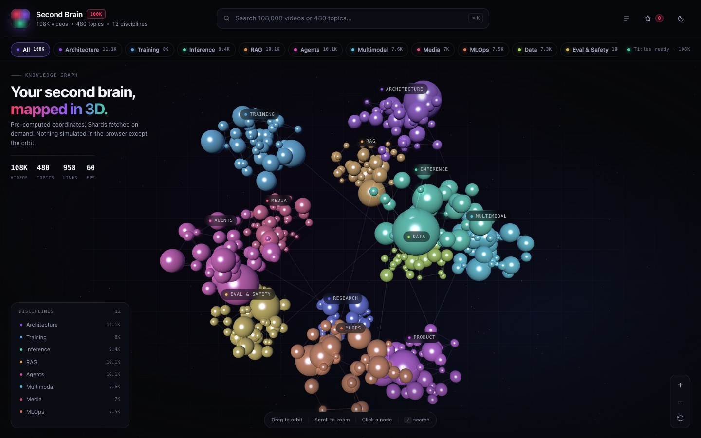
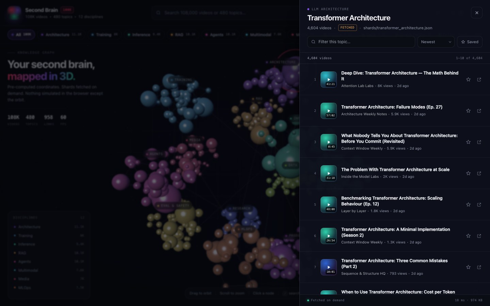
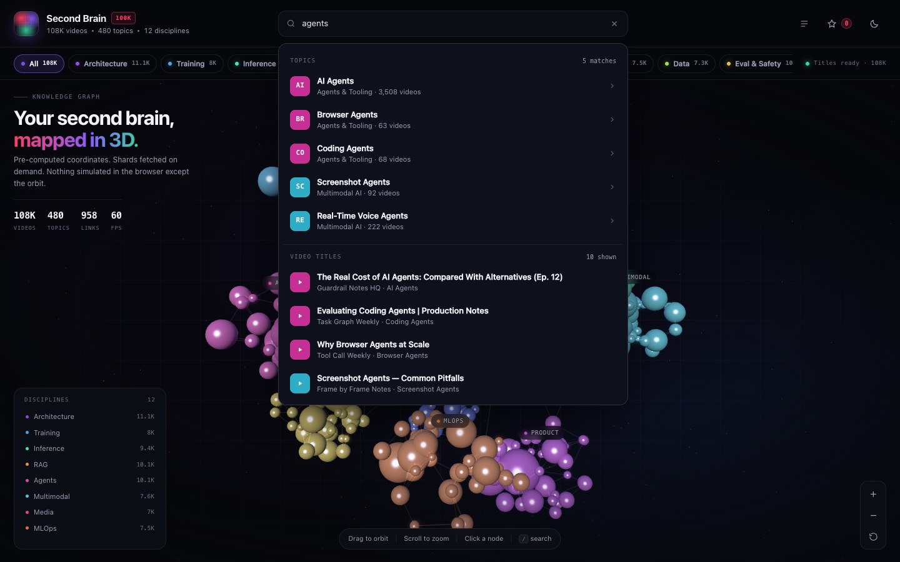
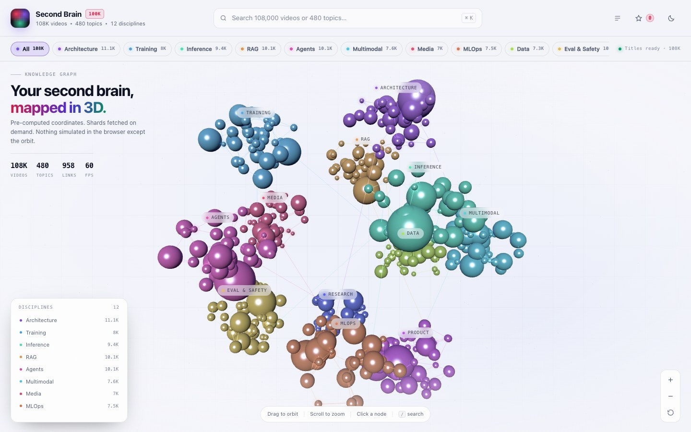
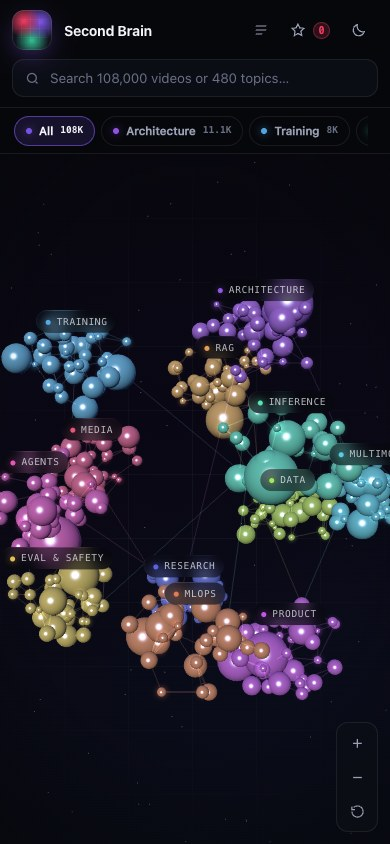
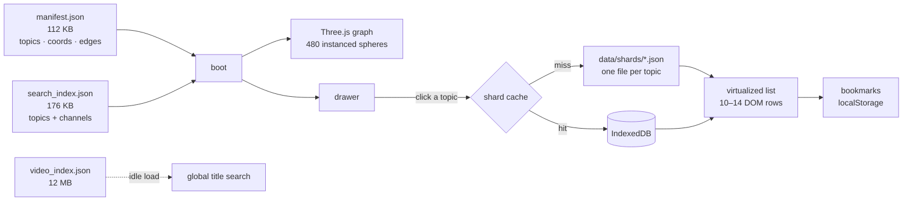

# YouTube Second Brain 100k

A **static, single-file application** that turns 108,000 YouTube-style video records into an explorable 3D knowledge graph. Topics are spheres, size is `log(video count)`, and a click lazy-loads only that topic's shard. Search spans the whole corpus, lists are virtualized, and bookmarks live in your browser.

No backend. No build step to deploy. No framework.

[**Live demo →**](https://somphol.github.io/youtube-second-brain/)



## What it is

- **108,000 videos across 480 topics and 12 disciplines**, laid out once at build time.
- **Sharded data**: `manifest.json` (112 KB) + `search_index.json` (176 KB) on boot; one shard (60–4,604 videos) only when you open a topic.
- **3D graph** in Three.js using pre-computed `x, y, z` coordinates. No force simulation runs in the browser.
- **60 FPS virtualized lists**: the DOM holds 10–14 video rows regardless of shard size.
- **Search at two scales**: topics and channels from the boot index; video titles from a deferred 12 MB MiniSearch index.
- **Bookmarks and theme** persist in `localStorage`; shards are cached in IndexedDB.
- **Dark and light themes**, keyboard navigation, focus trap, reduced-motion support, and a list-based fallback when WebGL is unavailable.

What it is **not**: a YouTube client, a scraper, a downloader, or a backend. The shipped corpus is synthetic (see [Data](#data)), and every "open" action goes to a YouTube search for that title — not to a real video page.

## Screenshots

| Topic drawer (virtualized) | Global search |
| --- | --- |
|  |  |

| Light theme | Mobile |
| --- | --- |
|  |  |

More in [`screenshots/`](screenshots).

## Quick start

```sh
# any static server works; fetch() needs HTTP, not file://
npx serve .            # or: python3 -m http.server 8080
# open http://localhost:3000 or http://localhost:8080
```

Repository tooling (Node 20+):

```sh
npm install            # dev-only: minisearch + puppeteer-core
npm run build:data     # regenerate the deterministic 108k corpus
npm run verify:data    # 67,990 corpus integrity checks
npm run serve          # local server on :9000
npm run verify         # 63 headless Chrome checks (release gate)
npm run screenshots    # regenerate screenshots + OG card
```

The app itself has **zero runtime npm dependencies**. Three.js, MiniSearch and Tailwind load from pinned CDNs. If every CDN is blocked, the topic index falls back to substring search, and the 3D view shows a browse-list fallback.

## Architecture



- **Boot** fetches the manifest and topic index, builds the scene, and paints. The 12 MB video-title index is requested from `requestIdleCallback` *after* first paint, streamed with progress, and cached in IndexedDB.
- **Every shard** is fetched on demand exactly once, then held in memory and IndexedDB. The drawer virtualizes on a fixed row height, so 4,604 rows cost the same DOM as 60.
- **Search** is split: the boot index answers "which topic?", the deferred index answers "which title?", and only the shards needed to resolve those titles are fetched.

Full detail: [docs/ARCHITECTURE.md](docs/ARCHITECTURE.md) · [docs/DATA-MODEL.md](docs/DATA-MODEL.md) · [docs/PERFORMANCE.md](docs/PERFORMANCE.md).

## Data

| Asset | Size | Loaded |
| --- | ---: | --- |
| `data/manifest.json` | 112 KB | boot |
| `data/search_index.json` | 176 KB | boot |
| `data/video_index.json` | 12.5 MB | idle, deferred |
| `data/shards/*.json` (480) | 21.4 MB | on demand |

The corpus is **synthetic**: 480 curated topics, 312 fictional channels and 108,000 generated titles, built deterministically from `scripts/taxonomy.mjs` with seed `20261113`. It exists so the 100k behaviours — sharding, lazy loading, virtualization, indexing — can be tested and demonstrated without redistributing YouTube metadata. View counts, durations and dates are generated for realism, not truth.

To use real data, keep the schemas in [docs/DATA-MODEL.md](docs/DATA-MODEL.md) and run `npm run verify:data`; the contract checks every shard, count, coordinate and index position.

## Features

- **3D knowledge network** — 480 instanced spheres, category clusters, 958 pre-computed links, hover tooltips, orbit/zoom/pinch, category focus, keyboard-accessible labels.
- **Topic drawer** — category, video count, shard source (`fetched` / `indexeddb` / `in memory`), fetch time and size.
- **Virtualized list** — fixed-height windowing with overscan; scrollbar spans the full shard.
- **Sorting and filtering** — newest, most viewed, longest, A–Z; title/channel search inside a shard; "saved only" toggle.
- **Search** — topics, channels and 108k titles; results resolve real video cards from their shards; recent topics on focus.
- **Bookmarks** — star any video; a "Saved" drawer works without the network; survives reloads and theme changes.
- **Deep links** — `#/topic/<id>`, `#/topic/<id>?v=<videoId>`, `#/saved`.
- **Resilience** — shard-level retry, IndexedDB fallback, substring search without MiniSearch, list view without WebGL, no blank states.

## Verification

The release gate runs real headless Chrome against a real static server:

```
✓ 63/63 browser checks passed
✓ data verified — 67,990 checks
```

It asserts, among other things: 108,000 records; no shard requested before interaction; the title index starts after first paint; a 4,604-row shard keeps ≤ 20 DOM rows at the top and after deep scrolling; bookmarks and theme survive reload; the second visit reads IndexedDB; search resolves real titles; deep links open the right topic; 390 px has no horizontal overflow; the drawer is full-width on mobile. See [docs/VERIFICATION.md](docs/VERIFICATION.md).

## Deploy

Push to `main`. [`.github/workflows/pages.yml`](.github/workflows/pages.yml) uploads the repository root to GitHub Pages.

One-time setup: **Settings → Pages → Source: GitHub Actions**. No secrets, no build command, no environment variables. The workflow can also be run manually.

## Project layout

```
index.html               the entire app: styles, 3D engine, data layer, UI
data/                    manifest, indexes, 480 shards, stats
scripts/build-data.mjs   deterministic corpus builder
scripts/taxonomy.mjs     480 topics, 12 disciplines, channel pools
scripts/verify.mjs       63 headless browser checks + screenshots
scripts/verify-data.mjs  67,990 corpus integrity checks
scripts/serve.mjs        dependency-free static server
docs/                    architecture, data model, performance, design, ops
state.json / STATE.md    build provenance, timing, token usage
```

## Credits

Built by **Somphol Boonjing** with **OpenCode 2.2.7** and **DeepSeek V4.1 Flash** (`opencode-go`). Full provenance, elapsed time and token usage: [`state.json`](state.json).

Three.js (MIT) · MiniSearch (MIT) · Tailwind CSS (MIT). Type stack: system sans + system mono. No stock imagery; the graph, icons, OG card and screenshots are generated by this project.

## License

[MIT](LICENSE) for the code and generated data. "YouTube" is a trademark of Google LLC; this project is not affiliated with or endorsed by YouTube.
